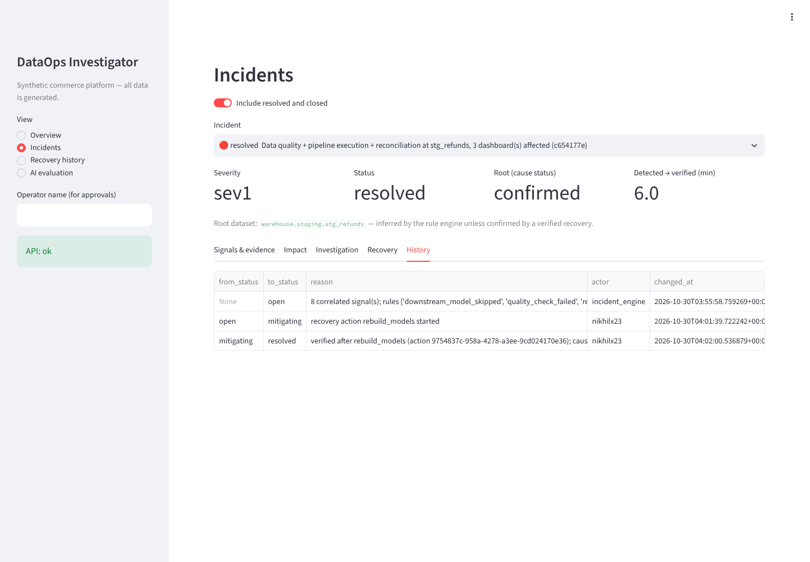

# DataOps Investigator

**AI Data Reliability Platform with Pipeline Impact Analysis and Evidence-Based Incident Investigation**

A portfolio project that builds an operational data platform for a *fictional* commerce
company, then a reliability and AI investigation layer around it. **All data is synthetic**;
this is a simulated environment, not a real company's production platform.

> **Status: Milestones 1–5 implemented and verified (data platform, CDC + lakehouse, Airflow,
> reliability platform, AI investigator, controlled recovery, failure scenarios, API,
> dashboard, Prometheus/Grafana). The AI investigator is verified only in its labelled
> offline fixture mode: the real-model evaluation has not run yet (no API key).
> Milestone 6 (benchmarks, final docs) is next.** See [docs/PROGRESS.md](docs/PROGRESS.md)
> for exactly what is implemented, verified, planned, and blocked. Nothing below claims more.

## The problem

When a pipeline breaks, engineers spend most of the time answering three questions: *what
actually failed, what is affected downstream, and is it fixed?* This project builds the
evidence trail (run metadata, schema observations, quality and reconciliation results,
lineage) needed to answer them, and later an AI investigator that may only cite that evidence.

## What works today (Milestone 1)

```
deterministic generator ──► PostgreSQL source (shop.*)
        │                          │  batch extraction: windowed, keyset-paginated,
        │                          ▼  overlap re-reads, content-deduplicated, atomic publish
        │                  warehouse raw.source_records + raw.ingestion_batches (manifest)
        │                          │  dbt (committed batches only)
        │                          ▼
        │                  staging views ──► marts.mart_daily_revenue (+ 35 data tests)
        ▼                          │
 expected-results ledger ──► reconciliation (source↔raw counts, source↔mart, ledger↔mart)
                                   ▼
                     reliability.reconciliation_results
```

- Seeded generator: customers, products with price history, orders, payments (pending,
  failed, succeeded, refunded), partial refunds, late captures, inventory movements,
  shipments with late and out-of-order events. Same seed → byte-identical data.
- Business rules defined first: [docs/business_rules.md](docs/business_rules.md).
- Separate databases and least-privilege roles for source, warehouse, reliability, Airflow.
- Boundary guarantees, including what is *not* guaranteed: [docs/architecture/guarantees.md](docs/architecture/guarantees.md).

## Quick start (lightweight, against any PostgreSQL 16 with pgvector)

Requirements: Python 3.12+, PostgreSQL 16 server you administer, `psql` ≥ 15.

```bash
python -m venv .venv && . .venv/bin/activate          # Windows: .venv\Scripts\Activate.ps1
pip install -e ".[dbt,dev]"
python scripts/init_env.py                             # writes .env with generated dev passwords
# set DATAOPS_PG_HOST/PORT and DATAOPS_PG_ADMIN_PASSWORD in .env to match your server
bash scripts/bootstrap_db.sh                           # PowerShell: scripts/bootstrap_db.ps1
bash scripts/demo_m1.sh                                # PowerShell: scripts/demo_m1.ps1
bash scripts/health.sh                                 # PowerShell: scripts/health.ps1
```

Expected end of the demo (default seed 42, `small` profile):

```
ingestion.row_counts.source_vs_raw       pass  rows=10 mismatches=0
revenue.daily.source_vs_mart             pass  rows=30 mismatches=0
revenue.daily.ledger_vs_mart             pass  rows=30 mismatches=0
```

### With Docker Compose (the app image build is not yet verified — see PROGRESS)

```bash
python scripts/init_env.py
bash scripts/up.sh lightweight                         # PowerShell: scripts/up.ps1
DATAOPS_RUNTIME=docker bash scripts/demo_m1.sh         # PowerShell: scripts/demo_m1.ps1 -Docker
bash scripts/down.sh                                   # keeps volumes; --delete-volumes removes them
```

## Milestone 2 demo: a simulated month of daily operations

```bash
python scripts/demo_m2.py --reset      # DESTRUCTIVE for the synthetic demo data only
```

The source advances one simulated day at a time; each day is extracted, dbt runs
incrementally every 5 days, then the incremental facts are compared with a full refresh and
reconciled against the source and the generator ledger.

## Full profile: CDC, streaming, lakehouse, Airflow

Kafka + Debezium capture every source change; Spark Structured Streaming lands them in Delta
Bronze, validates them against a versioned contract into Silver (bad records quarantined with
reasons), and a controlled publisher loads Silver into the warehouse in one transaction. dbt
runs unchanged on either path (`--vars '{source_path: cdc}'`). Airflow 3 schedules the
bounded work. Details, commands and measured memory: [docs/full_profile.md](docs/full_profile.md).

```bash
bash scripts/full_up.sh        # PowerShell: scripts/full_up.ps1
bash scripts/demo_full.sh      # PowerShell: scripts/demo_full.ps1
bash scripts/airflow.sh standalone
```

## Reliability platform

Collectors turn dbt artifacts, loader manifests, Airflow, Spark and Kafka metrics, freshness
and schema observations into one metadata model; a versioned lineage graph answers "what is
affected"; a deterministic engine groups correlated signals into one incident with an
inferred root and citable evidence. Details: [docs/reliability_platform.md](docs/reliability_platform.md).

```bash
python -m dataops collect
python -m dataops lineage impact commerce_source.shop.payments
python -m dataops incidents evaluate && python -m dataops incidents list
python scripts/demo_m3.py      # breaking schema change -> one incident with impact (reversible)
```

## AI investigator

A read-only investigator calls 11 allowlisted tools over the reliability metadata and an
indexed runbook corpus, then submits a structured explanation whose every citation, number
and recovery option is validated against stored evidence. Details:
[docs/investigator.md](docs/investigator.md); evaluation: [evaluations/](evaluations/README.md).

```bash
python -m dataops runbooks index
python -m dataops investigate <incident-id> --mode fixture   # labelled test harness, not AI
python -m dataops investigate <incident-id>                   # real model; needs ANTHROPIC_API_KEY in .env
python -m dataops eval --mode fixture                         # 35-case suite on isolated *_eval databases
```

## Recovery, scenarios, API, dashboard, monitoring



- **Recovery** ([guide](docs/recovery.md)): five predefined actions with typed scopes, live
  preconditions, dry runs, named-human approval, an audit log, and verification that
  re-evaluates the incident before marking its cause *confirmed*.
- **Failure scenarios** ([guide](docs/failure_scenarios.md), [actual runs](docs/results/scenarios/README.md)):
  eight reversible scenarios, each run end to end: inject → detect → investigate → recover →
  verify → clean up.
- **API** (FastAPI) and **dashboard** (Streamlit, talks only to the API); writes need a bearer
  token and a named actor. **Prometheus/Grafana** in the `monitoring` Compose profile.

```bash
uvicorn dataops.api.app:app --host 127.0.0.1 --port 8000       # or: docker compose --profile lightweight up -d api dashboard
streamlit run apps/dashboard/app.py                             # http://127.0.0.1:8501
docker compose --profile monitoring up -d                       # Prometheus :9090, Grafana :3000 (Linux host networking)
python -m dataops scenario run late_arriving_payments --actor "Your Name"
```

Screenshots from the running application: [docs/screenshots](docs/screenshots).

## Tests

```bash
pytest tests/unit                 # no services needed
pytest tests/integration          # needs PostgreSQL + .env; uses isolated *_test databases
ruff check . && ruff format --check . && mypy
```

## Limitations (current)

- Batch extraction cannot see hard deletes or intermediate versions between runs; the full
  profile's CDC path does.
- The CI workflow has not run yet (nothing has been pushed).
- Reloading the source with a *different* seed requires resetting the warehouse raw zone.
- The investigator has not been evaluated with a real model yet, and retrieval uses a lexical
  (non-neural) embedding by default.
- Scenario cleanups that remove inserted rows also remove their raw records (a harness step):
  batch extraction cannot observe deletes.
