# Architecture

All data is synthetic. Everything below runs locally (lightweight or full Compose profile).
Rendered: [overview.png](overview.png) (source below).

```mermaid
flowchart LR
  subgraph Source["Source (PostgreSQL: commerce_source)"]
    GEN["Seeded generator + time simulator"] --> SHOP[("shop.* tables")]
  end

  subgraph Batch["Lightweight path"]
    SHOP -- "windowed, keyset-paginated,\natomic batches" --> RAW[("warehouse.raw\nsource_records + manifests")]
  end

  subgraph Stream["Full profile path"]
    SHOP -- "logical replication\n(pgoutput)" --> DBZ["Debezium Connect"] --> KAFKA[("Kafka topics")]
    KAFKA --> BRONZE[("Delta Bronze\nexactly once per offset")]
    BRONZE -- "contract validation,\nLSN-guarded MERGE" --> SILVER[("Delta Silver\n+ quarantine")]
    SILVER -- "one-transaction publication" --> PUB[("warehouse.cdc_pub")]
  end

  RAW --> DBT["dbt: staging → dims/facts → marts\n+ tests"]
  PUB --> DBT
  DBT --> MARTS[("marts")] --> BI["BI dashboards\n(exposures)"]
  AF["Airflow 3: bounded DAGs,\nassets, writer pool"] -. schedules .-> Batch & Stream & DBT

  subgraph Reliability["Reliability platform (PostgreSQL: reliability)"]
    COL["Collectors: dbt artifacts, loader manifests,\nAirflow API, Spark progress, Kafka lag,\nfreshness, schema vs contract"]
    REC["Reconciliation:\nsource↔raw, source↔mart, ledger↔mart"]
    LIN["Versioned lineage\n(dbt manifest + declared)"]
    ENG["Incident engine:\nrules → correlation → inferred root → evidence"]
    COL --> META[("metadata model")]
    REC --> META
    LIN --> META
    META --> ENG --> INC[("incidents + evidence")]
  end
  DBT -. artifacts .-> COL
  MARTS -. checks .-> REC

  subgraph AI["Investigator (read-only)"]
    TOOLS["11 allowlisted tools\nrel_reader, SELECT only"] --> LOOP["bounded tool-use loop"]
    RB[("runbooks: pgvector + tsvector")] --> TOOLS
    LOOP --> VAL["validator: citations,\nnumbers, policy, abstention"]
  end
  INC --> TOOLS
  META --> TOOLS

  subgraph Recovery["Recovery service"]
    ACT["5 predefined actions:\npreconditions, dry run,\nhuman approval, audit"] --> VER["verification:\nre-collect + re-evaluate"]
  end
  VAL -. suggests .-> ACT
  ACT -- "backfill / retry / rebuild" --> RAW & DBT
  VER --> INC

  API["FastAPI\n/metrics"] --> META
  API --> AI
  API --> Recovery
  UI["Streamlit dashboard"] --> API
  PROM["Prometheus"] --> API
  GRAF["Grafana"] --> PROM
```

## Boundaries and who may write

| Component | Database role | May write |
|---|---|---|
| Generator, simulator, scenarios | `src_app` | source `shop.*` (synthetic) |
| Batch loader, Silver publisher | `wh_loader` | `raw.*`, `cdc_pub.*` |
| dbt | `wh_transform` | analytics schemas |
| CDC (Debezium) | `cdc_reader` | nothing (replication only) |
| Collectors, incident engine, recovery audit | `rel_app` | `reliability.*` |
| Investigator tools, API reads, metrics | `rel_reader` | nothing |
| Airflow metadata | `airflow` | its own database |

Design decisions: [ADRs](../adr/). Guarantees per boundary: [guarantees.md](guarantees.md).
