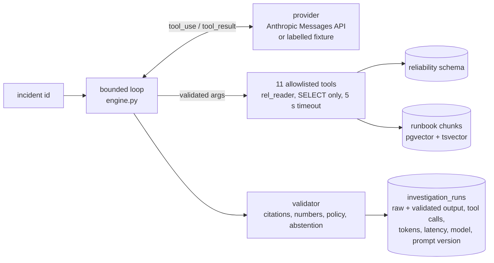

# AI investigator

One read-only investigator explains an incident from stored evidence. It cannot change
anything except writing its own audit row. All data is synthetic.



## Tools (`src/dataops/investigator/tools.py`)

`get_incident`, `get_failed_run`, `get_task_logs`, `get_schema_diff`, `get_quality_results`,
`get_dataset_freshness`, `get_lineage_impact`, `get_reconciliation_results`,
`search_runbooks`, `get_recent_changes`, `get_stream_health`.

- Each has a pydantic input model (`extra=forbid`, patterns on dataset ids, bounded windows).
  Invalid arguments are rejected before any query runs; unknown tools are refused.
- Each is a fixed parameterized query executed as `rel_reader` (SELECT-only role, statement
  timeout 5 s, one retry on a transient connection error). There is no SQL, shell, path or URL
  parameter anywhere.
- Every record carries an `evidence_id` (`ev:<table>:<key>`, `ev:lineage:<version>:<a>-><b>`,
  `doc:<chunk>@<version>`) that resolves to a stored row (`evidence.py`).
- Log text, error messages, connector traces and runbook text are returned as
  `{"untrusted_text": ...}`, redacted (passwords, keys, connection strings) and truncated.
  Evidence ids are only collected from evidence fields, never from untrusted text.
- Every record has `age_min` so the model can recognise stale evidence.
- A failing tool returns an error result; the loop continues and the model must list the gap.

## Limits (environment variables)

| Setting | Default |
|---|---|
| `DATAOPS_INV_MAX_TOOL_CALLS` | 12 (after that, tool calls are refused and submission is forced) |
| `DATAOPS_INV_MAX_TURNS` | 8 |
| `DATAOPS_INV_TOOL_RESULT_CHARS` | 12,000 per result (longest lists trimmed, marked `_truncated`) |
| `DATAOPS_INV_CONTEXT_CHARS` | 90,000 cumulative, then submission is forced |
| `DATAOPS_INV_WALL_S` | 300 |
| `DATAOPS_LLM_MAX_RETRIES`, `DATAOPS_LLM_TIMEOUT_S` | 2, 90 s (provider SDK retries) |

## Output (`schema.py`) and validation (`validate.py`)

The model must call `submit_investigation` with: abstain flag and reason, summary, observed
facts, likely causes (category, dataset, qualitative confidence with rationale, supporting and
conflicting evidence), affected datasets and paths, recommended checks, recovery options
(allowlisted actions only, each with scope and preconditions marked met/unmet/unknown),
missing evidence and evidence references.

What is displayed is the validated output; the raw output is kept for audit and evaluation:
- a citation counts only if a tool returned it in this investigation **and** it resolves to a
  stored record; others are removed and counted;
- a fact is removed if it has no valid citation or contains a number not present in the cited
  tool results (unit conversions s/min/h/day, cents/dollars accepted; integers 0–10 are treated
  as counts of listed items; identifiers and dates are not numeric claims);
- a cause is removed without valid supporting evidence; causes are always *inferred*;
- recovery text or checks proposing forbidden operations (drop/truncate/delete from, deleting
  checkpoints or slots, ad-hoc SQL, disabling tests) are removed; numeric confidence is removed;
- if no supported cause remains, the result becomes an abstention.

The investigator never changes incident state (tested) and never runs recovery.

## Retrieval (`runbooks.py`)

Seven original runbooks in `runbooks/` (YAML front matter: id, service, incident types,
version, effective date, owner). Section-aware chunking on `##` headings (long sections split on
paragraphs), file fingerprints for incremental indexing, replace-on-change and delete
propagation (tested), HNSW cosine index plus a `tsvector` index, reciprocal-rank fusion.
Citations are `doc:<chunk>@<version>` and resolve against the index.

Embedding providers (explicit, no silent fallback): `hashing` (default) is a deterministic,
**lexical, non-neural** feature-hashing vector — it matches shared words, not paraphrases;
`sentence-transformers` (all-MiniLM-L6-v2, 384-d) is implemented but **not verified here**:
the package and Hugging Face model download are not reachable from this build network.

## Modes

| Mode | What it is | Reported as |
|---|---|---|
| `model` | Anthropic Messages API with tool use (`DATAOPS_LLM_MODEL`, default `claude-sonnet-5-5`; evaluated with `claude-haiku-5-5`); key from `ANTHROPIC_API_KEY` in the local `.env` | real model results ([evaluation](../evaluations/README.md#results)) |
| `fixture` | `FixtureProvider`: fixed tool plan + rule mapping, deterministic. Exercises the same loop, tools, validator and audit | **not AI inference**; separate result directory; never in model metrics |

```bash
python -m dataops runbooks index
python -m dataops runbooks search "payments amount type changed"
python -m dataops investigate <incident-id> --mode fixture     # labelled test harness
python -m dataops investigate <incident-id>                     # real model (needs the key)
python -m dataops investigate <investigation-id> --show
python -m dataops eval --mode fixture                           # evaluation suite, see evaluations/
```
